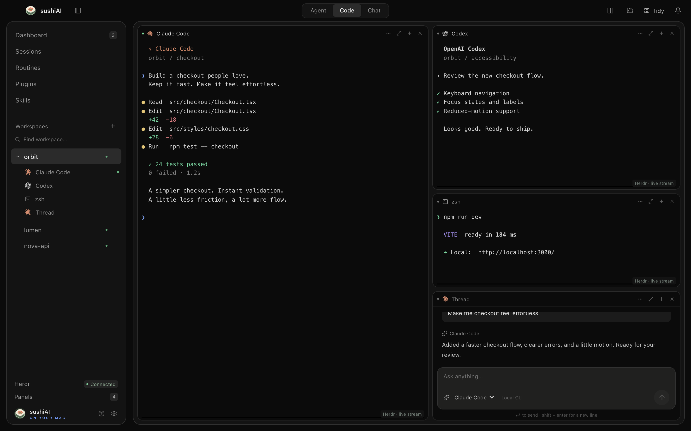

<p align="center"></p>
<h1 align="center">sushiAI</h1>
<p align="center">Your agents. One workspace.<br>A terminal workspace for macOS · MIT</p>



**sushiAI** brings agent terminals, chats, files, and Git diffs into one macOS window. Run Claude Code, Codex, and other agent CLIs with your installed tools and accounts. Sessions persist in the `sushiai` daemon, locally and over SSH.

[Watch the demo](promo/sushiAI-launch.mp4) · [Download the latest release](https://github.com/sushi-killer/sushiAI/releases/latest) · [Installation guide](docs/INSTALL.md)

The demo uses fictional projects and sample data.

## Install

**[Download the latest Apple Silicon DMG](https://github.com/sushi-killer/sushiAI/releases/latest)** from the release assets. It requires an M1 or newer Mac running macOS 13 or later.

Open the DMG, drag sushiAI to Applications, and launch it. The build is ad-hoc signed and is not Apple-notarized. See the [installation guide](docs/INSTALL.md) for first-launch instructions, checksums, tool setup, and [building from source](docs/INSTALL.md#build-from-source). Once installed, the app updates itself from **Settings → Software updates**.

## Features

- **Agents:** structured chat works with Claude Code and Codex through their installed CLIs. Other CLIs run as plain terminal sessions. The Agents view also covers Hermes.
- **Chat:** threads per project with pinning and renaming. Each thread keeps its agent, model, effort and permission mode; attach files and folders by dropping them into the composer. Codex models and reasoning levels are read from the installed CLI.
- **Workspaces:** draggable split panels, resizable dividers, and tabs that adapt to smaller windows.
- **Local and remote projects:** connect to a host over SSH using your existing SSH configuration.
- **Files and Git:** browse directories, preview text, images, PDFs and static HTML, edit UTF-8 files with conflict detection, and inspect branches, commits and diffs without checkout.
- **Skills:** scan local agent skills, group them by harness, and edit `SKILL.md`.
- **Project controls:** enable or disable Claude Code MCP servers and plugins per project without deleting their configuration.
- **Orchestrator (orchd):** the `sushiai` daemon hosts an orchestrator module that plans and runs agent tasks on your hosts. Every setting is documented in [orchestrator settings](docs/orchestrator-settings.md).
- **Routines:** describe a task once and an agent runs it on a schedule in the background. See [Routines](docs/routines.md).
- **Projects, Vault and environments:** a project groups its checkouts across hosts and carries environment values for its tasks and sessions. Values can be read from HashiCorp Vault with a read-only token stored in the macOS Keychain, and a project can keep its values off a host.
- **Model providers:** configure providers and model profiles, including the context window used for each model, and choose them per thread or task.
- **Extensions:** add pages, panes and cards with a JSON manifest, see below.

## Workspaces and sessions

Use **+**, **⌘K**, or **⌘T** to add a terminal, agent, browser, Files & Git panel, or chat. Drag a panel header to another panel's center to swap them, or to its edge to split the layout. Drag dividers to resize panels; double-click a header to maximize it. **Tidy** restores and balances the layout. When space is limited, panels switch to tabs and the sidebar collapses.

Open the **Inbox** to see what needs you, answer permission requests with **Allow** or **Deny**, and clean up idle sessions. **Hide** removes a view while **End** stops the session.

Sessions continue when sushiAI quits and reattach when it opens again. Save file edits before quitting; unsaved drafts are kept only in memory.

## Sessions and remote hosts

Every terminal and agent runs in a session of the `sushiai` daemon, a small background process the app starts for you. Sessions survive an app restart or crash: open the app again and each panel reattaches to its session with the same screen. The daemon lives in `~/.sushiai`; the app and `sushiai status` talk to it over a local socket.

Sessions a host already runs that this app has no panel for, such as ones started on another machine or by the `sushiai` CLI, appear in the sidebar and the Inbox; click one to attach.

For a remote project:

1. Verify that SSH works in Terminal and accept the host key if prompted.
2. Open **Settings → Connections → Add SSH host**.
3. Enter an SSH alias or `user@host` and an optional port. A host that is reached through a local command (for example a jump or tunnel tool) can use **Connect with a command** instead of SSH.
4. Choose **Save and connect**. If the host has no `sushiai` yet, **Install sushiai** on the host card uploads the matching build over SSH.
5. Open a workspace or create one using an absolute remote project path.

The remote host needs Python 3, Git, and the agent CLIs you want to run; Codex sessions need codex-cli 0.160 or newer. sushiAI uses your system SSH configuration, keys, and agent. Remote browser URLs such as `http://localhost:3000` are forwarded through SSH automatically.

Panels saved by an older release that ran in a different session backend come back as **Session ended** with **Reopen**, which starts a new session (and resumes an agent's own session when it has one).

## Files and editing

Open **Files & Git** with the folder button in the toolbar. Choose **Edit**, then **Save** or **⌘S** to update an existing UTF-8 file up to 2 MB. If the file changes on disk, saving is rejected and your draft remains available.

File previews support files up to 16 MB; text output is limited to 2 MB. Static HTML previews support relative assets. Open development servers by URL in a browser panel. Git views show changes; use a terminal for commits and other Git operations.

## Software updates

Open **Settings → Software updates** to check for a new release. Packaged builds check this project's public GitHub Releases shortly after startup and every six hours; downloads are verified against the release asset's SHA-256 digest, and **Install and restart** applies them. Automatic downloads never install on their own. No GitHub account is required. See the [installation guide](docs/INSTALL.md#update-the-app) for details.

## Keyboard shortcuts

| Action                             | Shortcut            |
| ---------------------------------- | ------------------- |
| Add a panel or session             | ⌘K / ⌘T             |
| Close the selected panel           | ⌘W                  |
| Select panel 1–9                   | ⌘1 … ⌘9             |
| Next / previous panel              | ⌘⇧] / ⌘⇧[           |
| Navigate a focused tab bar         | ← / →, Home / End   |
| Toggle sidebar                     | ⌘B                  |
| Maximize selected panel            | ⌘Enter              |
| Exit maximized view or dialog      | Esc                 |
| Save a text file                   | ⌘S                  |
| Send a message / insert a new line | Enter / Shift Enter |

## Extensions

Extension API v1 is JSON. A folder with a `manifest.json` declares pages, workspace panes, dashboard cards, sidebar entries and toolbar actions; the app renders them itself and never loads code from the folder. Drop the folder into `~/Library/Application Support/sushiai-workspace/local-extensions/<your-extension>/`, press **Reload** on the Extensions page, and enable it.

An extension that needs live data can point a view at a companion: a native program installed outside the folder that serves the view's values. See [companion processes](docs/extensions/companion.md) and [icons](docs/extensions/icons.md). `tests/fixtures/extensions/probe/manifest.json` declares every host, placement, layout and field type the contract allows.

## Development

Requires Node.js 22.18+, npm, and Xcode Command Line Tools.

```sh
git clone https://github.com/sushi-killer/sushiAI.git
cd sushiAI
npm ci
npm run dev
```

```sh
npm test              # Unit tests
npm run build         # Type checking and production build
npm run test:desktop  # Desktop smoke with a daemon of its own (builds `sushiai` if missing)
npm run test:terminal # Terminal rendering and input
npm run lint          # ESLint
npm run ci:web        # Full web gate used by CI
```

For SSH integration tests, set `SUSHIAI_SSH_HOST` to a test host that has `sushiai` installed, then run `npm run test:remote`. Integration tests create temporary workspaces and files and clean them up afterward.

Run `node scripts/updates-smoke.mjs` for isolated desktop checks of the update flow using synthetic release data.

See the [build instructions](docs/INSTALL.md#build-from-source) to package the app. `npm run dev:web` provides a UI preview; terminals, SSH, editing, and CLI chats require the desktop app.

## License

sushiAI source and original demo media are available under the [MIT License](LICENSE). Dependencies and icons retain their respective licenses; see [third-party notices](THIRD_PARTY_NOTICES.md). sushiAI is an independent project.
